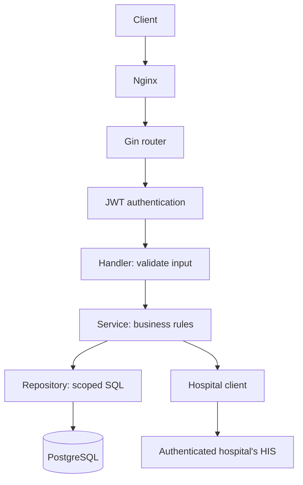

# Architecture

The middleware authenticates hospital staff and restricts every patient query/import to that staff member's hospital. PostgreSQL stores hospital configuration, staff credentials and imported patients. The provided HIS contract supports national ID or passport ID lookup only.

## Separation of responsibilities

`cmd/api` wires dependencies and owns process lifecycle. Handlers validate HTTP inputs and map errors. Middleware authenticates tokens and protects provisioning. Services own login/search/import rules and depend on repository/HIS interfaces. Repositories use pgx with bound SQL parameters. The hospital client owns transport, timeout, bounded decoding and response validation. Config and database packages own environment validation, pooling, migrations and seed. See the README tree for file locations.

## Search algorithm

1. Verify HS256 JWT, issuer, audience, expiry and subject. Load current staff; reject deleted staff or changed hospital/username.
2. Validate supported filters and pagination. Hospital scope cannot be supplied by the caller.
3. Query the authenticated hospital's local patients. Return matching rows.
4. If no rows and no national/passport ID, return an empty array.
5. Check the identity without other filters/pagination. An existing identity that fails a name filter or is beyond the requested page must not cause an upstream refresh.
6. For an absent identity, select that hospital's stored base URL. Prefer national ID if both IDs were supplied.
7. Call `GET {base_url}/patient/search/{escaped_id}` with a timeout. Treat upstream 404 as absent; report transport/status/payload errors separately.
8. Validate response fields and both supplied identifiers. Discard upstream internal/hospital IDs and use the authenticated hospital.
9. Upsert by `(hospital_id, patient_hn)`, then reapply all filters and pagination through the repository.

Local data is a snapshot, not a complete/current HIS roster. Name, phone, email and birth-date searches find only imported patients. Complete discovery or refresh would require another provider contract or a sync process. No cache expiration is implemented.

## Authentication and permissions

Staff creation requires a shared administrative provisioning key that authorizes creating staff in configured hospitals. It prevents public self-enrollment into an arbitrary hospital. Normal staff JWTs do not grant provisioning access. Login uses username, password and hospital code; incorrect combinations share the same 401 response. bcrypt uses default cost, and passwords exceeding 72 bytes are rejected.

JWTs contain staff ID, hospital ID, username, subject, issuer, audience, issued-at and expiry (default one hour). Current staff is checked on each request. There is no refresh token or logout API. Password changes alone would need a token-version/revocation policy if that feature is added.

## Operations

Compose order: PostgreSQL health -> migrations -> hospital seed -> backend health -> Nginx. The optional demo profile adds mock HIS. Readiness checks PostgreSQL connectivity, not HIS availability, allowing login and cached searches during upstream failures.

The API bounds request/header/response sizes and HTTP timeouts, propagates cancellation and shuts down gracefully. Logs contain route templates, statuses and duration, without patient query strings, bodies or credentials. Errors do not expose database/upstream internals. The local stack binds ports to loopback and needs TLS/independent secrets for public deployment.
