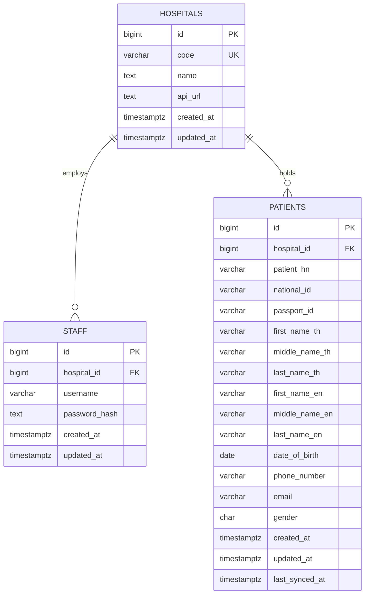

# Database schema

- Generated bigint primary keys; `hospitals.code` unique.
- `staff(hospital_id, username)` and `patients(hospital_id, patient_hn)` unique. Same username/HN may occur in different hospitals.
- National/passport IDs are nullable strings, not globally unique. Phone is a string; birth date is `DATE` without timezone. Patient fields other than HN/hospital may be null. Gender check permits `M`/`F` or null.
- Foreign keys prevent orphans; no cascading hospital deletion.
- Indexes: `(hospital_id, national_id)`, `(hospital_id, passport_id)`, `(hospital_id, id)` for scoped lookup/listing.
- Name substring search has no dedicated index in this assignment; consider trigram search after measuring real data.
- Repository/seed explicitly update `updated_at`; no trigger handles manual DB changes.
- `schema_migrations(version, applied_at)` is a separate technical table.

Schema: [`001_initial.up.sql`](../migrations/001_initial.up.sql).
